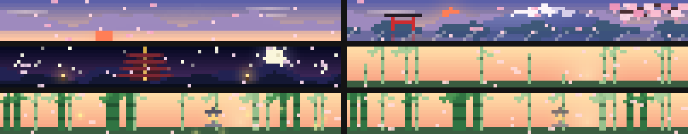

# 桜 sakura-zen

> Designed by **Martin Yu**

Statusline animada en pixel-art para Claude Code (CLI, VS Code y app de escritorio). Mientras Claude trabaja caen petalos de sakura y un paisaje japones se construye capa por capa: **Fuji al amanecer**, **pagoda bajo la luna** y **bosque de bambu**.



## Requisitos
- Node.js (ya viene con Claude Code en la mayoria de instalaciones)
- Terminal con color verdadero: Windows Terminal, iTerm2, Ghostty, WezTerm, Kitty, VS Code.
  En el Terminal.app de macOS se usa un modo automatico de 256 colores.
- Claude Code con soporte de `statusLine.refreshInterval`

## Instalar
```
git clone https://github.com/<tu-usuario>/sakura-zen.git
node sakura-zen/scripts/install.js
```
Reinicia Claude Code. No muevas la carpeta despues de instalar (el instalador guarda su ruta).

Opciones del instalador:
- `--interval N`  segundos entre frames (default 3)
- `--no-refresh`  solo se actualiza con eventos (si te molesta al copiar/pegar)
- `--256`         fuerza 256 colores (macOS Terminal.app)
- `--remove`      desinstala (backup en `settings.json.sakura-backup`)

## Personalizar
- `SAKURA_H` altura en filas (default 6)
- `SAKURA_NO_SIGNATURE=1` oculta la firma de la statusline
- Tiempos: `SCENE_SECS` y `BUILD_SECS` en `scripts/sakura.js`

## Rendimiento
Cada frame es un proceso Node de ~40 ms y ~50 MB de pico que termina solo; no deja nada corriendo.

## Licencia
MIT (c) 2026 Martin Yu
